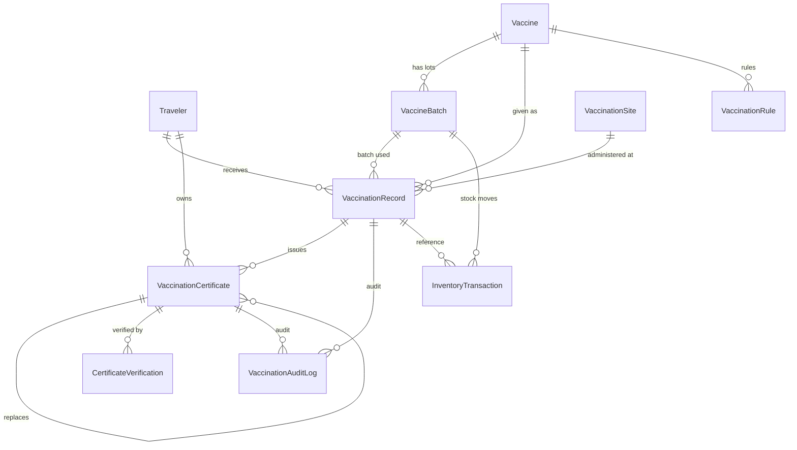

# 02_Database_Schema — Actual Implemented Models

> **Last synced with code:** `main @ b55a533` (2026-10-20)
>
> This document reflects the **implemented** Django models in
> `backend/apps/vaccination/models.py`. Fields that were previously documented
> but do not exist are listed under
> [Planned / Not Implemented](#12-planned--not-implemented).

## Overview

**9 models** in `backend/apps/vaccination/models.py` (Django app label
`vaccination`; tables use Django's default naming `vaccination_<model>`):

1. `Vaccine` → `vaccination_vaccine`
2. `VaccineBatch` → `vaccination_vaccinebatch`
3. `VaccinationSite` → `vaccination_vaccinationsite`
4. `VaccinationRecord` → `vaccination_vaccinationrecord`
5. `VaccinationRule` → `vaccination_vaccinationrule`
6. `VaccinationCertificate` → `vaccination_vaccinationcertificate`
7. `CertificateVerification` → `vaccination_certificateverification`
8. `VaccinationAuditLog` → `vaccination_vaccinationauditlog`
9. `InventoryTransaction` → `vaccination_inventorytransaction`

**All models extend `core.models.BaseModel`**, which contributes:

| Field | Type | Notes |
|---|---|---|
| `id` | `UUIDField` | primary key, `default=uuid.uuid4`, not editable |
| `created_at` | `DateTimeField` | `auto_now_add=True` |
| `updated_at` | `DateTimeField` | `auto_now=True` |

The fields below list **model-specific** columns only; the three base fields
apply to every table.

## 1. `Vaccine` — أنواع اللقاحات

| Field | Type | Constraints / Default | Notes |
|---|---|---|---|
| `code` | `CharField(40)` | **unique** | internal code (e.g. `YF`, `OPV`) |
| `who_code` | `CharField(40)` | blank | WHO code |
| `name_ar` | `CharField(120)` | required | Arabic name |
| `name_en` | `CharField(120)` | blank | English name |
| `route` | `CharField(15)` | choices `ORAL \| INJECTION \| INTRANASAL \| OTHER`, default `INJECTION` | administration route |
| `series` | `PositiveSmallIntegerField` | default `1` | primary series doses |
| `booster_required` | `BooleanField` | default `False` | |
| `interval_days` | `PositiveIntegerField` | `null`, blank | interval between doses |
| `validity_days` | `PositiveIntegerField` | `null`, blank | certificate validity |
| `required` | `BooleanField` | default `False` | mandatory for travel |
| `description` | `TextField` | blank | |
| `order` | `PositiveSmallIntegerField` | default `0` | display order |
| `is_active` | `BooleanField` | default `True` | |

`Meta`: `ordering = ['order', 'name_ar']`.

## 2. `VaccineBatch` — تشغيلات اللقاح (LOT)

| Field | Type | Constraints / Default | Notes |
|---|---|---|---|
| `vaccine` | FK → `Vaccine` | `PROTECT`, `related_name='batches'` | |
| `lot_number` | `CharField(60)` | **unique** | LOT number |
| `manufacturer` | `CharField(120)` | blank | |
| `manufacture_date` | `DateField` | `null`, blank | |
| `expiry_date` | `DateField` | required | |
| `received_quantity` | `PositiveIntegerField` | default `0` | quantity received |
| `available_quantity` | `PositiveIntegerField` | default `0` | quantity remaining |
| `status` | `CharField(10)` | choices `ACTIVE \| DEPLETED \| EXPIRED \| RETURNED`, default `ACTIVE` | |
| `received_at` | `DateTimeField` | `auto_now_add=True` | |

`Meta`: `ordering = ['expiry_date']`.

## 3. `VaccinationSite` — عيادات ونقاط التطعيم

| Field | Type | Constraints / Default | Notes |
|---|---|---|---|
| `name_ar` | `CharField(150)` | required | |
| `name_en` | `CharField(150)` | blank | |
| `kind` | `CharField(15)` | choices `CLINIC \| PORT_POINT`, default `CLINIC` | |
| `entry_point` | FK → `masterdata.EntryPoint` | `SET_NULL`, `null`, blank, `related_name='vaccination_sites'` | port of entry |
| `location` | `CharField(150)` | blank | |
| `address` | `CharField(255)` | blank | |
| `phone` | `CharField(30)` | blank | |
| `is_active` | `BooleanField` | default `True` | |

`Meta`: `ordering = ['name_ar']`.

## 4. `VaccinationRecord` — جرعات اللقاح المُعطاة

| Field | Type | Constraints / Default | Notes |
|---|---|---|---|
| `traveler` | FK → `travelers.Traveler` | `CASCADE`, `related_name='vaccination_records'` | |
| `vaccine` | FK → `Vaccine` | `PROTECT`, `related_name='records'` | |
| `batch` | FK → `VaccineBatch` | `SET_NULL`, `null`, blank, `related_name='records'` | |
| `dose_type` | `CharField(10)` | choices `FIRST \| SECOND \| THIRD \| BOOSTER`, default `FIRST` | |
| `dose_number` | `PositiveSmallIntegerField` | default `1` | |
| `administered_at` | `DateField` | required | date the dose was given |
| `site` | FK → `VaccinationSite` | `SET_NULL`, `null`, blank, `related_name='records'` | |
| `vaccinator` | FK → `AUTH_USER_MODEL` | `SET_NULL`, `null`, blank, `related_name='vaccination_administered'` | clinician who gave the dose |
| `recorded_by` | FK → `AUTH_USER_MODEL` | `SET_NULL`, `null`, blank, `related_name='vaccination_recorded'` | user who recorded it |
| `notes` | `TextField` | blank | |
| `status` | `CharField(10)` | choices `GIVEN \| CANCELLED`, default `GIVEN` | |

`Meta`: `ordering = ['-administered_at']`.

## 5. `VaccinationRule` — قواعد تقييم احتياج المسافر

| Field | Type | Constraints / Default | Notes |
|---|---|---|---|
| `vaccine` | FK → `Vaccine` | `CASCADE`, `related_name='rules'` | |
| `title_ar` | `CharField(150)` | required | |
| `destination_region` | `CharField(100)` | blank | |
| `min_age_days` | `PositiveIntegerField` | `null`, blank | |
| `max_age_days` | `PositiveIntegerField` | `null`, blank | |
| `required` | `BooleanField` | default `True` | |
| `doses_required` | `PositiveSmallIntegerField` | default `1` | |
| `validity_days` | `PositiveIntegerField` | `null`, blank | |
| `note` | `TextField` | blank | |

`Meta`: `ordering = ['vaccine__name_ar']`.

## 6. `VaccinationCertificate` — الشهادات الدولية

| Field | Type | Constraints / Default | Notes |
|---|---|---|---|
| `traveler` | FK → `travelers.Traveler` | `CASCADE`, `related_name='vaccination_certificates'` | |
| `record` | FK → `VaccinationRecord` | `SET_NULL`, `null`, blank, `related_name='certificates'` | source dose |
| `vaccine` | FK → `Vaccine` | `SET_NULL`, `null`, blank | denormalized from the record |
| `certificate_number` | `CharField(40)` | **unique** | `AFY-VAC-` + 6 digits |
| `status` | `CharField(10)` | choices `ACTIVE \| REVOKED \| EXPIRED`, default `ACTIVE` | `EXPIRED` normally derived, not written |
| `issued_by` | FK → `AUTH_USER_MODEL` | `SET_NULL`, `null`, `related_name='issued_vaccination_certificates'` | |
| `issued_at` | `DateTimeField` | `auto_now_add=True` | |
| `valid_until` | `DateField` | required | |
| `validity_days` | `PositiveIntegerField` | default `0` | |
| `qr_token` | `UUIDField` | **unique**, `default=uuid.uuid4` | QR/verification token |
| `verification_path` | `CharField(200)` | blank | `/verify/vaccination/<number>` |
| `replaces` | FK → `self` | `SET_NULL`, `null`, blank, `db_index=True`, `related_name='replacement_chain'` | replacement chain |
| `replacement_reason` | `CharField(100)` | `null`, blank, default `''` | |
| `replaced_at` | `DateTimeField` | `null`, blank | set on the **original** when replaced |

`Meta`: `ordering = ['-issued_at']`.

Manager: `VaccinationCertificateQuerySet` — `.active()` filters
`status=ACTIVE` **and** `valid_until >= today` (so expired-but-`ACTIVE`
certificates are excluded).

Derived (not columns): `effective_status` (returns `EXPIRED` when `ACTIVE` and
`valid_until` has passed), `is_valid`, `verification_signature` (HMAC-SHA256
over `certificate_number` + `qr_token`, derived on every read — never stored),
`verification_url(base)`.

> **Superseded fields** from the previous revision of this document are listed
> under [Planned / Not Implemented](#12-planned--not-implemented).

## 7. `CertificateVerification` — سجل عمليات التحقق

Append-only log of verification attempts (public QR scans and officer checks).

| Field | Type | Constraints / Default | Notes |
|---|---|---|---|
| `certificate` | FK → `VaccinationCertificate` | `CASCADE`, `related_name='verifications'` | |
| `verified_by` | FK → `AUTH_USER_MODEL` | `SET_NULL`, `null`, blank, `related_name='vaccination_certificate_verifications'` | `null` for anonymous public scans |
| `success` | `BooleanField` | default `True` | |
| `ip_address` | `GenericIPAddressField` | `null`, blank | client IP, truncated to 45 chars by the view |
| `note` | `CharField(200)` | blank | e.g. signature mismatch note |

`Meta`: `ordering = ['-created_at']`.

## 8. `VaccinationAuditLog` — تدقيق دورة حياة الشهادة

Replaces the lifecycle-log table described in the previous revision (see
[Planned / Not Implemented](#12-planned--not-implemented)). Written inside the
same transaction as the certificate mutation (audit failure rolls the mutation
back).

| Field | Type | Constraints / Default | Notes |
|---|---|---|---|
| `action` | `CharField(20)` | choices `ISSUE \| REPLACE \| REISSUE \| REVOKE` | |
| `certificate` | FK → `VaccinationCertificate` | `SET_NULL`, `null`, blank, `related_name='audit_logs'` | affected certificate |
| `source_certificate` | FK → `VaccinationCertificate` | `SET_NULL`, `null`, blank, `related_name='derived_audit_logs'` | original on replace/reissue |
| `record` | FK → `VaccinationRecord` | `SET_NULL`, `null`, blank, `related_name='certificate_audit_logs'` | |
| `user` | FK → `AUTH_USER_MODEL` | `SET_NULL`, `null`, blank, `related_name='vaccination_audit_logs'` | |
| `details` | `JSONField` | default `dict`, blank | e.g. `certificate_number`, `replacement_reason` |

`Meta`: `ordering = ['-created_at']`.

> Note: `VaccinationAuditLog` is **not** registered in `admin.py` (only 8 of the
> 9 models are).

## 9. `InventoryTransaction` — حركات المخزون

| Field | Type | Constraints / Default | Notes |
|---|---|---|---|
| `batch` | FK → `VaccineBatch` | `CASCADE`, `related_name='transactions'` | |
| `type` | `CharField(10)` | choices `IN \| OUT \| ADJUST \| EXPIRED` | |
| `quantity` | `PositiveIntegerField` | required | |
| `reference_record` | FK → `VaccinationRecord` | `SET_NULL`, `null`, blank, `related_name='inventory_transactions'` | dose that consumed stock |
| `created_by` | FK → `AUTH_USER_MODEL` | `SET_NULL`, `null`, blank, `related_name='vaccination_inventory_transactions'` | |
| `note` | `CharField(250)` | blank | |

`Meta`: `ordering = ['-created_at']`.

## 10. Relationships

Key cardinalities:

- `Traveler` 1:N `VaccinationRecord` (`related_name='vaccination_records'`).
- `Traveler` 1:N `VaccinationCertificate` (`related_name='vaccination_certificates'`).
- `VaccinationRecord` 1:N `VaccinationCertificate` — in practice **at most one
  active** certificate per traveler + vaccine + record (enforced in
  `services.issue_certificate`, not by a DB constraint).
- `VaccinationCertificate` self-FK `replaces` (N:1) — replacement/reissue chain;
  at most one direct reissue child is enforced in the service layer.
- `CertificateVerification` → certificate `CASCADE`; `VaccinationAuditLog` →
  certificate/record `SET_NULL` (history survives deletion of the target, since
  certificates are never deleted through the API).

## 11. Indexes & Constraints

| Table | Column | Constraint |
|---|---|---|
| `vaccination_vaccine` | `code` | UNIQUE |
| `vaccination_vaccinebatch` | `lot_number` | UNIQUE |
| `vaccination_vaccinationcertificate` | `certificate_number` | UNIQUE |
| `vaccination_vaccinationcertificate` | `qr_token` | UNIQUE |
| `vaccination_vaccinationcertificate` | `replaces_id` | `db_index=True` |
| all tables | `id` | PRIMARY KEY (UUID) |

Django auto-creates indexes for every `ForeignKey` (`*_id`). There are **no
explicit `Meta.indexes` or `Meta.constraints`** in these models.

> Note: the index list in the previous revision referenced columns that do not
> exist — see [Planned / Not Implemented](#12-planned--not-implemented).

## 12. Planned / Not Implemented

The following were documented in earlier revisions but are **not implemented**:

| Previously documented | Reality |
|---|---|
| `vaccination_certificates.disease_id` (FK → `diseases`) | **Not present.** The disease dimension is the `vaccine` FK; there is no `diseases` FK and no ICD-11 linkage on the certificate. |
| `vaccination_certificates.qr_hash` | **Not present.** Actual field is `qr_token` (`UUIDField`, unique). The QR signature is derived (`verification_signature`), never stored. |
| `vaccination_certificates.file_url` | **Not present.** Certificates are not file-based; there is no S3/MinIO attachment and no upload flow. |
| `vaccination_certificates.verification_status` (`PENDING/VERIFIED/REJECTED`) | **Not present.** Certificate state is `status` (`ACTIVE/REVOKED/EXPIRED`); verification attempts are recorded separately in `CertificateVerification`. |
| `vaccination_certificates.verified_by_id` / `verified_at` | **Not present.** The verifier and time live on `CertificateVerification.verified_by` + `created_at`. |
| `vaccination_certificates.vaccine_name` / `batch_number` / `dose_number` / `dose_date` / `expiry_date` / `issuing_country` / `issuing_authority` | **Not present.** These live in `VaccinationRecord` (`vaccine` FK, `batch` FK, `dose_number`, `administered_at`) and `VaccinationCertificate.valid_until`; the certificate reaches them through `record`. |
| Table `vaccination_logs` (`action_type`, `old_data`, `new_data`, `performed_at`) | **Not present.** Split into `VaccinationAuditLog` (lifecycle: ISSUE/REPLACE/REISSUE/REVOKE, `details` JSON) and `CertificateVerification` (verification attempts). |
| Index on `vaccination_certificates.qr_hash` | **Not present** (no such column). |

## 13. References

- Source of truth: `backend/apps/vaccination/models.py`
- Base model: `backend/core/models/base.py` (`BaseModel`)
- Migrations: `backend/apps/vaccination/migrations/`
  (`0001_initial.py`, `0002_certificate_lifecycle.py`,
  `0003_vaccinationauditlog.py`)
- Admin: `backend/apps/vaccination/admin.py` (8 models registered)
- API: `docs/04_Modules/13_Vaccination_System/03_Vaccination_API.md`
  (reconciled in PR #85)
- Workflow/UI: `04_Vaccination_Workflow.md`, `05_Vaccination_UI_UX.md`
